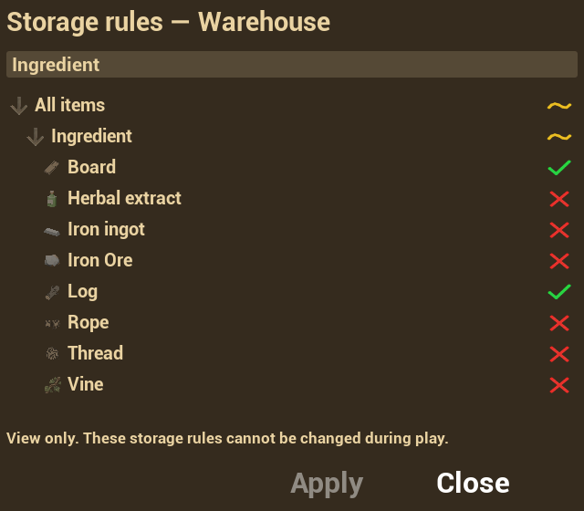

# Storage admission rules

Language: [Русский](../ru/StorageAdmission.md) | **English**

Each inventory has its own rules for accepting categories and individual item definitions from outside. A station's input, fuel and output inventories can have different rules.

## Using the rule tree

Open storage and press the category icon in its operations panel. The dialog contains search, a category/item tree, Apply and Close. Each row has one state symbol; there are no separate Exclude or Effective rule columns.

| Symbol | State | Clicking the symbol |
|---|---|---|
| Green check | Item allowed; all category contents allowed | Block the item or the entire branch |
| Red cross | Item blocked; all category contents blocked | Allow the item or the entire branch |
| Yellow wave | Only part of the category is allowed | Allow the entire branch |

A category summarizes all its children. Allowing only Log under Ingredient gives Log a green check, other items red crosses, and Ingredient and its ancestors yellow waves. A category with a single allowed item and no other children is fully allowed.

The left arrow expands or collapses a branch; the right symbol changes admission. Toggling a category affects its whole branch, including items hidden by search. Searching changes neither rules nor aggregate states: the category remains partial even when only its allowed Log item is shown.

Edits first change a draft. **Apply** submits it to the server. **Close**, Escape and closing without applying discard the draft. Ending interaction closes the dialog.

## Editor configuration

In the container component, open the relevant `StartupInventories → Settings → Inventory | Admission` entry:

| Field | Purpose |
|---|---|
| `AdmissionRules.AllowedCategories` | Initial allowed Gameplay Tag categories and descendants |
| `AdmissionRules.AllowedItems` | Initial allowed item definitions by Data Table and Row Name |
| `AdmissionRules.ExcludedCategories` | Initial excluded categories and descendants |
| `AdmissionRules.ExcludedItems` | Initial excluded item definitions |
| `bAllowAdmissionRulesEditing` | Enable in-game editing; false by default |

Empty allowance lists with no exclusions accept everything. If categories or items are listed as allowed, only matching definitions are accepted. Explicit exclusions take precedence in the initial configuration.

Exclusion fields remain available for initial configuration and save compatibility; the in-game tree has no separate Exclude mode. It builds rules from selected contents. After blocking a branch, allowing one child makes that item admissible and the branch partial. Blocking the root is stored explicitly rather than as an empty list, which would mean accept everything.

With `bAllowAdmissionRulesEditing = false`, the open-rules button remains available. Players can inspect states, search and expand branches, but cannot change admission; Apply is unavailable. The permission belongs to the individual inventory, not the entire actor.

Dynamic backpacks use `CharacterBagTemplate` rather than an ordinary `StartupInventories` entry for initial settings. Neither the template nor the item row currently exposes admission rules or editing permission. See [portable backpacks](PortableBackpacks.md) for internal container support and server integration points.

## Priority and transfers

The inventory-wide filter is checked before cell requirements. A permissive cell cannot override a storage rejection. When storage accepts an item, cell category requirements, dimensions, space, weight and other limits still apply.

Rules apply to drag/drop, quick transfers, replenishing an existing stack and bulk operations. Existing blocked contents are preserved: they can be moved, rotated, split, merged and sorted within the same inventory, and removed. Returning or replenishing them from outside is rejected.

| Panel action | Behavior |
|---|---|
| View rules | Open the tree for viewing or editing |
| Move permitted items | Transfer permitted types from the player's current main inventory, including types absent from storage |
| Restock existing types (`+=`) | Transfer only types already stored, subject to the same admission rules |

Bulk operations skip blocked items and stacks affected by reservations. If an eligible item only partially fits, its remainder stays at the source. The ordinary Place all action also respects admission. See [restocking storage](RestockStorage.md).

## Catalogs, labels and symbols

Configure `Project Settings → Invenza Inventory → Admission`:

- `AdmissionCategoryRoot`: tree root, defaulting to `Item.Category`. Unrelated service tags are omitted.
- `AdmissionItemTables`: `FItemData` tables whose definitions appear under categories. The server also uses these catalogs to validate individual item edits. Add your own item table here.
- `AdmissionCategoryLabels`: localized `FText` category labels. The fallback is the short tag name; a tooltip provides the full path.
- `AdmissionWindowClass`: dialog Widget Blueprint class.

The interface is authored in `UI/Inventory/Admission/WBP_InventoryAdmission` and `WBP_InventoryCategoryTreeRow`. Textures are `Textures/UI/Admission/T_AdmissionAllowed`, `T_AdmissionBlocked` and `T_AdmissionPartial`. Configure the row's Class Defaults through `AllowedStateBrush`, `BlockedStateBrush` and `PartialStateBrush`.

Labels and tooltips live in `Data/Localization/ST_InvenzaRuntimeTexts` under `Invenza.Admission.*`. Storage buttons live in `UI/Core/OperationsPanel/WBP_Inventory_OperationsPanel`. Custom panels can use Core buttons named `Button_AdmissionRules` and `Button_PlaceAllowed`.

## Persistence and server validation

Rules replicate and persist per inventory. The server validates access, editing permission, categories and item definitions. Trusted client item-state submissions cannot overwrite server rules.

Saves without admission state use configured initial rules. Loading preserves existing blocked contents. Craft results blocked by a changed filter remain in the pending-delivery queue until they can be inserted.

## Checking your setup

1. Block the root, then allow one item. Check for a green item, red siblings and partial ancestors.
2. Search for that item. Its category must remain partial.
3. Click a category's partial symbol, then its allowed symbol: the whole branch should become allowed, then blocked. Apply and check transfers.
4. Block an existing item. Check internal moves and splitting, withdrawal, and rejection of return or replenishment from outside.
5. Disable editing and verify viewing, then save and load the state. In network projects, also test applying changes from a client.
