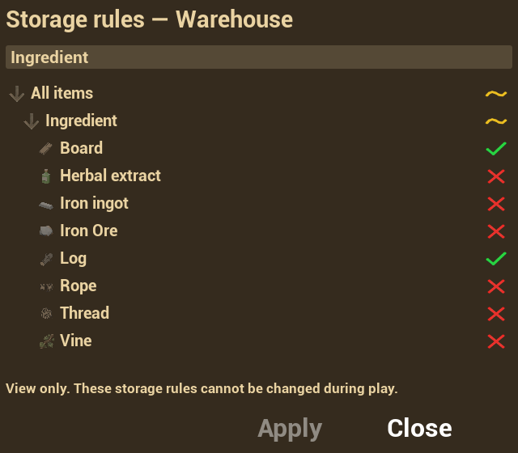

# Разрешённые предметы хранилища

Язык: **Русский** | [English](../en/StorageAdmission.md)

У каждого инвентаря свои правила приёма категорий и конкретных предметов извне. Вход, топливо и выход одной станции могут иметь разные правила.

## Окно правил

Откройте хранилище и нажмите кнопку с иконкой категорий в панели операций. Окно содержит поиск, дерево категорий и предметов, Apply и Close. В строке один значок состояния; колонок Exclude и Effective rule нет.

| Значок | Состояние | Нажатие на значок |
|---|---|---|
| Зелёная галочка | Предмет разрешён; у категории разрешено всё содержимое | Запретить предмет или всю ветку |
| Красный крест | Предмет запрещён; у категории запрещено всё содержимое | Разрешить предмет или всю ветку |
| Жёлтая волна | В категории разрешена часть содержимого | Разрешить всю ветку |

Категория суммирует все дочерние элементы. Если разрешить только Log внутри «Ингредиентов», у него появится зелёная галочка, у остальных предметов — красные кресты, а у категории и её родителей — жёлтая волна. Категория с единственным разрешённым предметом и без других дочерних элементов будет полностью разрешённой.

Стрелка слева раскрывает или сворачивает ветку; значок справа меняет разрешение. Выбор категории затрагивает всю ветку, включая элементы, скрытые поиском. Сам поиск не меняет состояния: если показан только разрешённый Log, его категория остаётся частичной, пока в ней есть запрещённые предметы.

Изменения сначала относятся к черновику. **Apply** отправляет его серверу; **Close**, Escape и закрытие без применения отменяют черновик. При завершении взаимодействия окно закрывается.

## Настройка в редакторе

В компоненте контейнера откройте нужную запись `StartupInventories → Settings → Inventory | Admission`:

| Поле | Назначение |
|---|---|
| `AdmissionRules.AllowedCategories` | Начальные разрешённые категории Gameplay Tags и их потомки |
| `AdmissionRules.AllowedItems` | Начальные разрешённые предметы по Data Table и Row Name |
| `AdmissionRules.ExcludedCategories` | Начальные исключения категорий и их потомков |
| `AdmissionRules.ExcludedItems` | Начальные исключения отдельных предметов |
| `bAllowAdmissionRulesEditing` | Разрешить изменение правил в игре; по умолчанию выключено |

Пустые списки разрешений без исключений принимают всё. Если указаны разрешённые категории или предметы, принимаются только совпадающие определения. В начальных настройках явное исключение сильнее разрешения.

Поля исключений сохранены для начальной настройки и совместимости сохранений; отдельного режима Exclude в игровом окне нет. Дерево формирует правила из выбранного содержимого. После запрета ветки можно разрешить один предмет внутри неё: предмет станет доступен, а ветка — частично разрешённой. Запрет корня сохраняется явно, а не как пустой список, который означал бы разрешение всего.

При `bAllowAdmissionRulesEditing = false` кнопка открытия остаётся доступной. Игрок видит состояния, ищет предметы и раскрывает ветки, но не может изменить разрешения; Apply недоступен. Флаг относится к конкретному инвентарю, а не ко всему актору.

Для динамических рюкзаков начальные настройки создаются из `CharacterBagTemplate`, а не из обычной записи `StartupInventories`. В шаблоне и строке предмета пока нет полей фильтра и права редактирования. Поддержка правил внутренним контейнером и точки серверной настройки описаны в разделе [рюкзаков](PortableBackpacks.md).

## Приоритет и перенос

Общий фильтр проверяется перед ограничениями ячеек. Разрешающая ячейка не отменяет запрет хранилища. Если хранилище разрешает предмет, продолжают действовать категория ячейки, размеры, свободное место, вес и остальные ограничения.

Правила учитываются при перетаскивании, быстром переносе, добавлении количества к существующему стаку и массовых операциях. Уже лежащие запрещённые вещи сохраняются: их можно перекладывать, поворачивать, разделять, объединять и сортировать внутри того же инвентаря, а также забирать. Вернуть их или пополнить извне нельзя.

| Кнопка панели | Действие |
|---|---|
| Просмотр правил | Открыть дерево для просмотра или редактирования |
| Переместить разрешённое | Перенести разрешённые виды из текущего основного инвентаря игрока, включая отсутствующие в хранилище |
| Пополнить имеющиеся (`+=`) | Перенести только уже присутствующие виды с учётом тех же правил |

Массовая операция пропускает запрещённые предметы и стаки, затронутые резервированием. Если подходящий предмет помещается частично, остаток остаётся в источнике. Обычная кнопка «Положить всё» также соблюдает фильтр. Подробнее: [пополнение хранилищ](RestockStorage.md).

## Каталоги, подписи и значки

В `Project Settings → Invenza Inventory → Admission` доступны:

- `AdmissionCategoryRoot` — корень дерева; по умолчанию `Item.Category`. Служебные теги за его пределами не выводятся.
- `AdmissionItemTables` — таблицы структуры `FItemData`, предметы которых появляются под категориями. Эти же таблицы допускаются сервером в запросах изменения правил. Добавьте сюда свою таблицу предметов.
- `AdmissionCategoryLabels` — локализуемые `FText`-подписи категорий. Без подписи выводится короткое имя тега; полный путь доступен в подсказке.
- `AdmissionWindowClass` — класс Widget Blueprint окна.

Интерфейс создаётся в `UI/Inventory/Admission/WBP_InventoryAdmission` и `WBP_InventoryCategoryTreeRow`. Изображения находятся в `Textures/UI/Admission`: `T_AdmissionAllowed`, `T_AdmissionBlocked`, `T_AdmissionPartial`. В Class Defaults строки кисти задаются через `AllowedStateBrush`, `BlockedStateBrush` и `PartialStateBrush`.

Подписи и подсказки находятся в `Data/Localization/ST_InvenzaRuntimeTexts`, ключи `Invenza.Admission.*`. Кнопки хранилища находятся в `UI/Core/OperationsPanel/WBP_Inventory_OperationsPanel`; собственная панель может использовать Core-кнопки с именами `Button_AdmissionRules` и `Button_PlaceAllowed`.

## Сохранение и сервер

Правила реплицируются и сохраняются для конкретного инвентаря. Сервер проверяет доступ, право редактирования и присланные категории и определения предметов. Доверенная отправка клиентом состояния предметов не позволяет переписать серверные правила.

Сохранения без состояния правил используют начальные настройки. Загрузка восстанавливает уже лежащие запрещённые предметы. Если фильтр препятствует доставке результата крафта, очередь ожидающих доставок удерживает результат до возможности его разместить.

## Проверка своей конфигурации

1. Запретите корень, затем разрешите один предмет. Проверьте зелёную галочку у предмета, красные кресты у соседей и жёлтый знак у родителей.
2. Найдите этот предмет поиском. Родитель должен остаться частично разрешённым.
3. Нажмите жёлтый значок категории, затем зелёный: вся ветка должна сначала разрешиться, затем запретиться. Примените изменения и проверьте перенос.
4. Запретите уже лежащий предмет. Проверьте внутреннее перемещение и разделение, извлечение и отказ при возврате или пополнении извне.
5. Выключите редактирование, проверьте просмотр, затем сохраните и загрузите состояние. В сетевом проекте отдельно проверьте применение с клиента.
